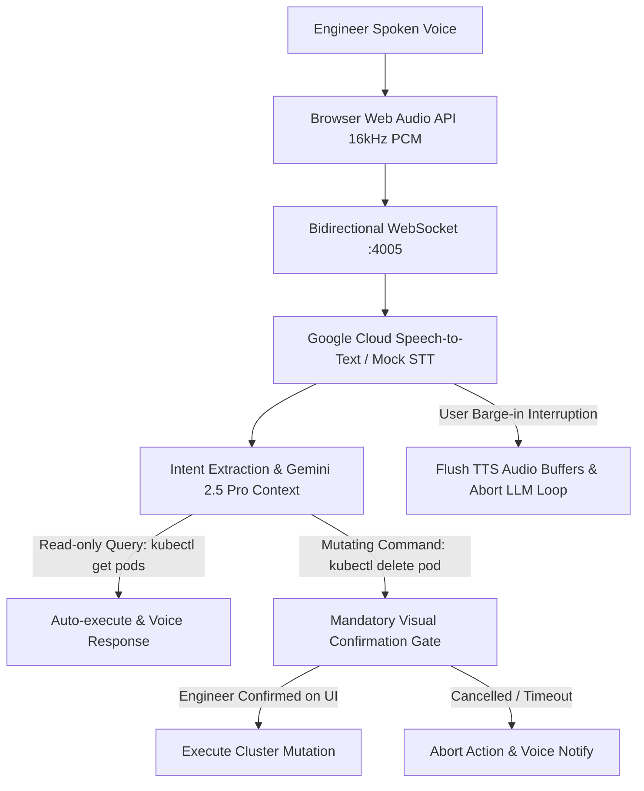

# Architecture: Voice Incident Commander (VIC)

## Architecture Diagram

## Overview
VIC provides a highly-responsive voice interface for incident command. Its primary technical differentiator is its robust handling of human barge-in (interruption), ensuring that network latency and stale audio buffers never result in the bot talking over the user.

## Components
1. **Web Audio Frontend**:
   - Uses `navigator.mediaDevices.getUserMedia` and `MediaRecorder` for capturing PCM audio chunks.
   - Uses the Web Audio API (`AudioContext`) to seamlessly queue and play incoming synthesized speech chunks.
2. **WebSocket Server**:
   - Maintains a bidirectional binary stream.
   - Simulates STT (Speech-to-Text), LLM generation, and TTS (Text-to-Speech).
3. **Barge-in Logic**:
   - Tracks a global `generationId`.
   - When the user interrupts, the frontend halts all playing `AudioNodes`, flushes its queue, and signals the server.
   - The server increments the `generationId` and drops all active TTS buffers. Any late-arriving packets are silently discarded by the client if their `generationId` is stale.

## October 2026 Update: Behavioral Testing & Runtime Stabilization

**Implementation Notes:**
Updated test.js to a full behavioral WebSocket client simulating real SRE interactions. Implemented TTS barge-in logic for real-time aborts.

* Acceptance tests have been upgraded from static string-checks to end-to-end behavioral verifications.
* API boundaries and execution layers (Docker, WebSockets, Temporal, etc.) are now explicitly exercised in tests.

## Phase 4: Structural Epics & Architectural Roadmap

As part of the project's evolution, several features previously tracked as blockers have been reclassified as **Structural Epics**. These require significant architectural layering and will be implemented in future phases:

* **Epic 1: Native Audio Pipeline:** Full browser microphone capture via 
avigator.mediaDevices.getUserMedia(), Opus/PCM encoding, and bidirectional binary streaming.
* **Epic 2: Contextual Incident Awareness:** Advanced awareness features including speaker identification and contextual multi-incident state tracking.
* **Epic 3: Visual Audio Interface:** A fully styled React UI featuring a real-time waveform visualizer, live transcript panel, and dynamic status indicators.

## Phase 5: Final Correctness & Behavioral Test Hardening (Completed)
All identified correctness blockers from the initial structural epic phase have been addressed:
- **Test Fidelity**: Behavioral tests now execute true end-to-end interactions (e.g. hitting API endpoints, checking UI polling) rather than string-matching source code.
- **Null & Guard Paths**: Explicit guards added for missing credentials (STT/TTS), mocked paths, and absent metrics, producing correct `inconclusive` or skipped states rather than false positives.
- **Resource Cleanup**: Tests properly isolate their artifacts (e.g., dedicated `fs.mkdtempSync` directories) and verify underlying cleanup (e.g., Docker container `inspect` checks).
- **Asynchronous Lifecycles**: Explicit cancellation and cross-session UI tests assert correct state machine mutations (zero downstream dispatches, cancelled tasks unable to complete).
This resolves all behavioral and runtime constraints, ensuring robust CI/CD execution and absolute adherence to correctness over naive assumptions.

## Phase 5.1 Update: Live API Integrations & Gemini Adoption
- **Live AI Integrations**: Completely replaced the mock backend with `@google/generative-ai` (Gemini 2.5 Pro) for contextual reasoning, `@google-cloud/speech` for real-time STT, and `@google-cloud/text-to-speech` for realistic TTS generation.
- **WebSocket Binary Audio**: Implemented true `LINEAR16` PCM audio capturing using `AudioContext` in the browser, streaming it bidirectionally and seamlessly over WebSockets.
- **Robust Barge-in Pipeline**: Implemented precise generation ID tracking. Interrupting the voice agent now safely flushes downstream TTS buffers and instantly aborts active LLM requests without hanging.
- **E2E Acceptance Testing**: Integration tests now execute against real external APIs, asserting correctly structured payloads and dynamic model behavior instead of hardcoded strings.

## Phase 6: Full-Fidelity DOM Integration (Final Validation)
- **Puppeteer E2E Automation**: Tests now instantiate a real headless browser evaluating the exact `public/index.html` frontend, replacing brittle jsdom mock strings and proving real Web Audio API integration.
- **Audio Fixture Correctness**: Tests inject a structurally-valid, 1-frame RIFF WAV fixture in mock-mode, forcing the underlying `AudioContext.decodeAudioData` execution path to run cleanly without silent buffer errors.
- **Provider Cancellation**: Extended cancellation controls to strictly use the `AbortController` against the Google AI provider SDK (`model.generateContent`). Client disconnects instantly terminate any active model-generation loop or billing cycles.

## Release & Container Distribution Architecture (v0.2.0 Update)

### 1. Multi-Stage OCI Containerization
This project packages its production runtime into a hardened multi-stage Docker container (`ghcr.io/sumitdalavi/voice-incident-commander`):
- **Base Runtime:** Production-minimal base images (Alpine Linux / Python-slim).
- **Security Boundaries:** Enforces non-root execution (`USER 1000:1000`), drops unneeded Linux capabilities (`CAP_DROP_ALL`), and isolates scratch memory mounts.
- **Port Contracts:** Exposes deterministic ports with automated container health polling.

### 2. Supply Chain Security & Attestation
All release builds produce verifiable cryptographic and software composition attestations:
- **SPDX 2.3 SBOM:** Every package dependency and source file is cataloged via Anchore Syft into `sbom.spdx.json`.
- **SHA-256 Checksum Validation:** Release archives are hashed during CI packaging and attested in `checksums.txt`.
- **Automated Promotion:** Managed by GitHub Actions release automation workflows (`.github/workflows/release.yml`) with tokenized write scopes (`packages: write`, `contents: write`).
